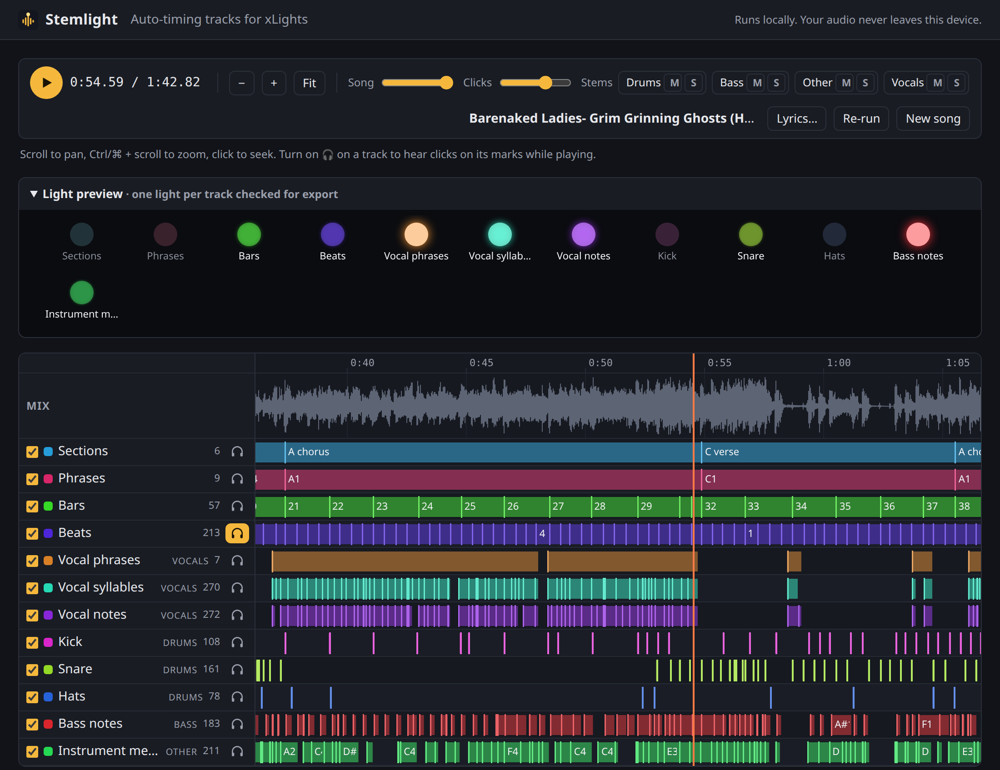
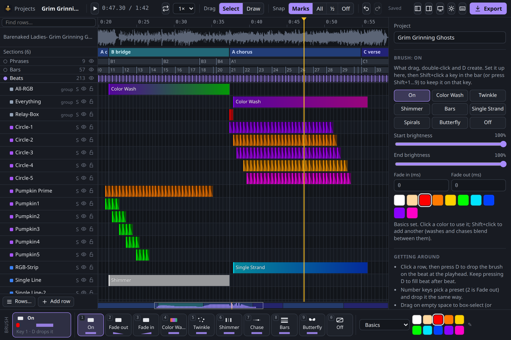
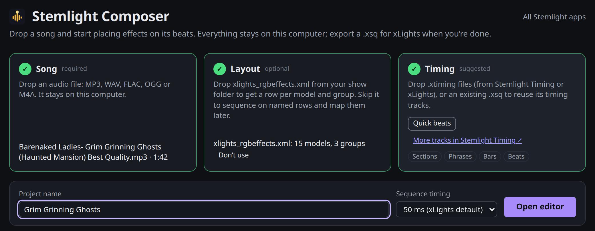

# Stemlight

**Free, in-browser tools for sequencing light shows in [xLights](https://xlights.org).**

Stemlight listens to a song and gives you timing tracks for it: sections, bars and beats, drums, bass, vocal phrases, syllables, notes and lyrics. It also has a fast editor for laying effects onto those beats. When you're done, you open the result in xLights to fine-tune and render.

**[Open Stemlight →](https://thulrus.github.io/stemlight/)**

Everything runs in your browser. There's nothing to install, no account, and your audio never leaves your computer.

## Stemlight Timing

Drop in a song and get timing tracks to import into your sequence.



- **Always included:** Sections, Phrases, Bars and Beats, ready in a few seconds.
- **With stem separation:** the song is split into drums, bass, vocals and other, which adds Kick, Snare, Hats, Bass notes, Vocal phrases, Vocal syllables, Vocal notes and Instrument melody.
- **With lyrics:** paste them, or let it transcribe them, to get Lyric lines, Lyric words, labeled syllables, and a phonemes track that xLights singing faces use directly.
- **Marks have a start *and* an end.** A sung note lasts as long as it's sung, so an effect snapped to it doesn't need fixing.
- **Split a track between props**, e.g. alternate beats between two pumpkins, or put low notes on one prop and high notes on another.

### How to use it

1. Open **Stemlight Timing** and drop an audio file (MP3, WAV, FLAC, OGG or M4A). Already have stems? Drop them in with the song, named `drums`, `bass`, `vocals` and `other`.
2. Pick the options you want on the start screen. Each one runs an AI model that downloads once (170–460 MB each) and is cached after that. The extra vocal options need a GPU.
3. Play the song and watch the light preview (one light per track), or click 🎧 on a track to hear a click on every mark. Tweak any track with its sliders.
4. Click **Download .xtiming**, then in xLights right-click a timing track and choose **Import Timing Track**.

## Stemlight Composer

Lay out a sequence fast. Every effect snaps to your timing tracks, everything has a keyboard shortcut, and the result opens in xLights as a `.xsq`.



### How to use it

1. Open **Stemlight Composer** and drop your song. Optionally add `xlights_rgbeffects.xml` from your show folder to get a row for each of your models and groups.
2. Add timing: drop the `.xtiming` from Stemlight Timing, or click **Quick beats** for beats, bars, phrases and sections in a few seconds.

   

3. Click a spot on a row and press `D` to drop an effect on that beat (keep pressing to fill beat after beat), or press a number key for a preset (`2` is Fade out). Drag in Draw mode for longer effects like washes and chases. Press `?` to see every shortcut.
4. Click **Export** and open the `.xsq` in xLights to fine-tune and render.

Projects save in your browser after every change, and undo is unlimited.

## Browsers

Works in current Chrome, Edge and Firefox. GPU acceleration needs WebGPU, which Chrome and Edge have. Firefox on Linux doesn't ship it yet, so there everything runs on the CPU, more slowly, and the GPU-only options are off.

## Development

```sh
npm install
npm run dev     # dev server: / (landing), /timing/, /composer/
npm test
npm run build   # static site in dist/
```

Milestones, benchmarks, test tools and the code layout are in [docs/DEVELOPMENT.md](docs/DEVELOPMENT.md).

## License

[AGPL-3.0](LICENSE). Third-party notices are in [THIRD_PARTY_LICENSES](THIRD_PARTY_LICENSES). Stemlight is not affiliated with the xLights project.
